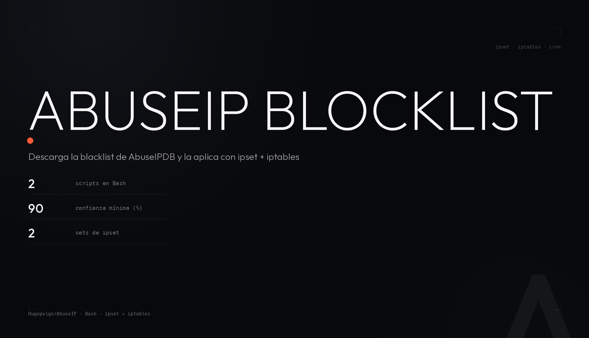

<p align="center">
  
</p>

<p align="center">
  <b>Dos scripts en Bash que conectan AbuseIPDB con el firewall del servidor.</b><br>
  Uno aplica la blacklist como ipset; el otro reporta a AbuseIPDB las IP que Fail2Ban banea.
</p>

<p align="center">
  
  
  
  
</p>

---

## Qué es esto

Un par de scripts en Bash para un servidor Linux con firewall:

| Script | Qué hace |
|---|---|
| `ban_abuseipdb.sh` | Descarga la blacklist de [AbuseIPDB](https://www.abuseipdb.com/) y la bloquea con `ipset` + `iptables`, en IPv4 e IPv6. |
| `report_ips.sh` | Lee las IP baneadas por Fail2Ban y las reporta a AbuseIPDB con la categoría que corresponde a cada jail. |

El primero es el que se programa en cron. El segundo se ejecuta a mano: no
viene instalado como action de Fail2Ban, es un script que se puede lanzar
cuando quieras.

**Por qué `ipset` y no `ip route blackhole`:** el método de rutas blackhole
acumula decenas de miles de entradas en la tabla de routing del kernel, y
`systemd-networkd` deja de arrancar (timeout enumerando rutas), con un crash
loop que satura la CPU. `ipset` guarda las IP en estructuras hash del kernel,
totalmente ajenas a la tabla de rutas.

## Requisitos

- Linux con `ipset`, `iptables` e `ip6tables`
- `curl` y `jq`
- Una clave de la API de AbuseIPDB ([se pide aquí](https://www.abuseipdb.com/api.html))

```bash
sudo apt install curl jq ipset iptables
```

## Bloquear la blacklist

Instalación:

```bash
sudo cp ban_abuseipdb.sh /usr/local/bin/
sudo chmod +x /usr/local/bin/ban_abuseipdb.sh
```

La clave **no va en el repositorio**: el script trae el placeholder
`your_abuseipdb_api_key`. Lo normal es leerla de un fichero de configuración
en el servidor:

```bash
# /etc/abuseipdb.conf, root:root y 600
echo 'ABUSEIPDB_API_KEY=tu_clave_real' | sudo tee /etc/abuseipdb.conf
sudo chmod 600 /etc/abuseipdb.conf
```

y sustituir en el script (línea 6):

```bash
source /etc/abuseipdb.conf
API_KEY="$ABUSEIPDB_API_KEY"
```

Primera ejecución:

```bash
sudo /usr/local/bin/ban_abuseipdb.sh
```

Qué hace, paso a paso:

1. Comprueba que estén `jq`, `curl`, `ipset` e `iptables`. Si no hay
   `ip6tables`, desactiva el IPv6 y sigue.
2. Crea los sets `abuseipdb` (inet) y `abuseipdb6` (inet6) si no existen, con
   `hash:ip`, `hashsize 65536` y `maxelem 500000`.
3. Inserta las reglas `DROP` en `INPUT` y `FORWARD` de `iptables` e
   `ip6tables`, solo si no estaban ya (es idempotente).
4. Descarga la blacklist con el umbral de confianza y separa IPv4 de IPv6.
5. Carga las IP en sets temporales y hace `ipset swap`: **el set activo nunca
   queda vacío** durante la actualización.
6. Guarda `ipset save` en `/etc/ipset.conf` y escribe el log en
   `/var/log/ban_abuseipdb.log`.

Lo que se puede ajustar, al principio del script:

| Variable | Por defecto | Para qué |
|---|---|---|
| `API_KEY` | `your_abuseipdb_api_key` | Clave de la API. |
| `CONFIDENCE_MIN` | `90` | Confianza mínima en porcentaje, tal cual la pide AbuseIPDB. |
| `ENABLE_IPV6` | `true` | Crear el set y las reglas de IPv6. |
| `LOG_FILE` | `/var/log/ban_abuseipdb.log` | Dónde va el log. |

## Programar con cron

```bash
crontab -e
```

```cron
# Actualizar la lista cada día a las 5 de la mañana
0 5 * * * /usr/local/bin/ban_abuseipdb.sh

# Restaurar los ipsets tras un reinicio (los sets se pierden al apagar)
@reboot sleep 30 && sudo ipset restore < /etc/ipset.conf 2>/dev/null || true
```

La segunda línea no es opcional: los sets de `ipset` viven en memoria y
desaparecen al reiniciar. Sin el `@reboot` el firewall se queda sin bloqueo
hasta la siguiente ejecución del script.

## Verificar el estado

```bash
# IPs bloqueadas ahora mismo
sudo ipset list abuseipdb | grep "Number of entries"
sudo ipset list abuseipdb6 | grep "Number of entries"

# Ver las IP del set
sudo ipset list abuseipdb | head -20

# Reglas de iptables activas
sudo iptables -L INPUT | grep abuseipdb
sudo iptables -L FORWARD | grep abuseipdb

# Log en tiempo real
tail -f /var/log/ban_abuseipdb.log
```

## Reportar las IP que banea Fail2Ban

`report_ips.sh` hace el camino inverso: lee `fail2ban-client banned`, se salta
la lista blanca (`/etc/ipabuse_whitelist.txt`) y las IP ya reportadas
(`/var/log/ipabuse_reported.log`), y manda cada una a la API con la categoría
que corresponde al jail:

| Jail | Categoría | Comentario que se envía |
|---|---|---|
| `sshd` | 22 | Intentos fallidos de inicio de sesión SSH. |
| `apache-auth` | 21 | Intentos fallidos de autenticación HTTP. |
| `apache-env-access` | 21,27 | Actividad sospechosa en entorno web. |
| `modsecurity` | 21,27,28 | Posible ataque detectado por ModSecurity. |
| cualquier otro | 18 | IP bloqueada por Fail2Ban [$jail]. |

Uso:

```bash
# pon la clave en API_KEY (línea 5) antes de la primera vez
sudo ./report_ips.sh
```

Los ficheros `ipabuse_whitelist.txt` e `ipabuse_reported.log` se crean solos en
`/etc` y `/var/log` si no existen.

## Consideraciones

- Requiere privilegios de root.
- La API limita las descargas de la blacklist según el plan (en el gratuito, una
  al día).
- Las reglas bloquean `INPUT` y `FORWARD`, que es lo que interesa si el
  servidor hace de router o gateway.
- Nunca subas al repositorio el script con la clave real.

## Estructura

```
AbuseIP/
├── ban_abuseipdb.sh   descarga la blacklist y la aplica con ipset + iptables
├── report_ips.sh      reporta a AbuseIPDB las IP baneadas por Fail2Ban
├── docs/capturas/     cabecera del README
└── LICENSE            CC BY-NC-SA 4.0
```

## Créditos

- La idea y la base del script de bloqueo son de
  [xRuffKez](https://github.com/xRuffKez/).
- [AbuseIPDB](https://www.abuseipdb.com/) por el servicio.

<div align="center">
  <a href="https://www.abuseipdb.com/user/193901" title="AbuseIPDB Contributor Badge">
    
  </a>
</div>

## Licencia

**CC BY-NC-SA 4.0** — se puede compartir y adaptar con atribución, siempre sin
uso comercial y bajo la misma licencia. Texto completo en
[LICENSE](LICENSE).

---

<div align="center">
  Hugo Pérez Vigo · [@hugopvigo](https://x.com/hugopvigo) ·
  [github.com/Hugopvigo](https://github.com/Hugopvigo)
</div>
